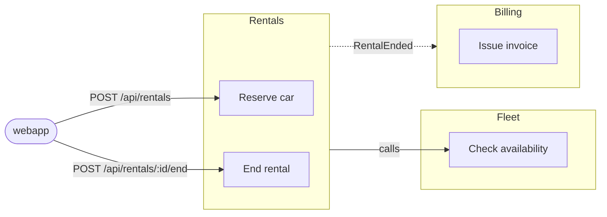

# Context map

How the bounded contexts fit together: what each exposes, what calls it, and which events flow between them. Each context's own document (`docs/domain/<context>.md`) has the detail; this is the one picture of the whole system.

<!-- Replace the example below with the real contexts. Conventions:
- One `subgraph` per bounded context, named as in docs/domain/. Inside it, one node per published use case or query.
- `webapp` calls a use case over HTTP: solid arrow labelled with the contract's method and path.
- One context calls another through its index.ts: solid arrow from the calling context to the use case, labelled `calls`.
- A context publishes a domain event (past tense): dashed arrow from the publishing context to each consumer, labelled with the event name.
- Generic subdomains or external services (payments provider, email) are plain nodes outside any subgraph. -->

Legend: solid arrow, a request (HTTP from the webapp, or a call through a context's `index.ts`); dashed arrow, a domain event from publisher to consumer.
